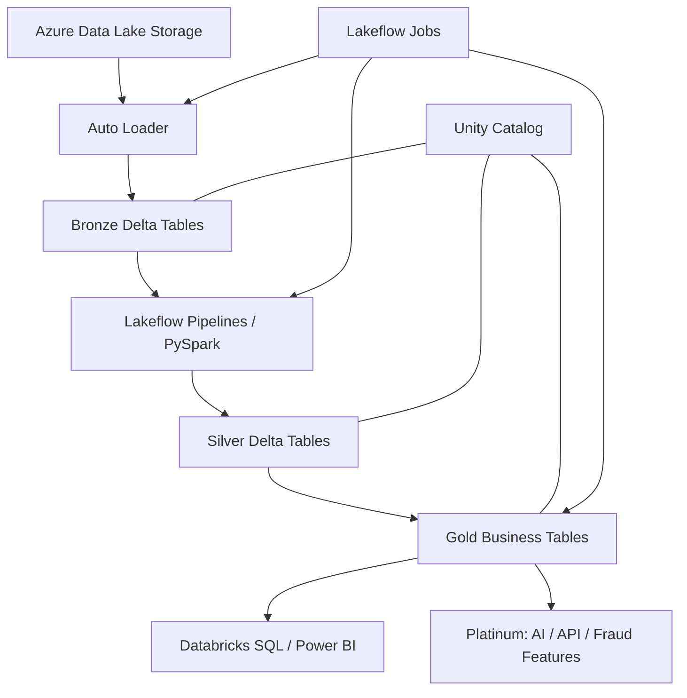

# Azure Databricks: Beginner-to-Advanced Data Engineering

> A hands-on training program for students who want to build practical data engineering skills using Azure Databricks, Apache Spark, PySpark, SQL, Delta Lake, Unity Catalog, and Lakeflow.

## Program Overview

This course takes students from the fundamentals of data engineering to building, scheduling, governing, and optimizing production-style data pipelines on Azure Databricks.

Two delivery options are included:

- **4-week accelerated program:** Best for students who already understand basic Python and SQL.
- **6-week comprehensive program:** Best for beginners who need additional explanation, guided practice, and project time.

The course follows a **learn → demonstrate → practice → build** approach. Students work with realistic datasets and create a complete Bronze, Silver, and Gold lakehouse solution.

## Recommended Prerequisites

Students should have:

- Basic computer and file-system knowledge
- Beginner-level SQL knowledge
- Beginner-level Python knowledge
- An interest in cloud and data engineering

The 6-week program includes Python, SQL, and data-engineering refreshers. Students with no previous Spark experience are welcome.

## Technology Stack

| Area | Technologies |
|---|---|
| Cloud | Microsoft Azure |
| Analytics platform | Azure Databricks |
| Processing | Apache Spark, PySpark, Spark SQL |
| Storage | Azure Data Lake Storage Gen2, Unity Catalog volumes |
| Table format | Delta Lake |
| Ingestion | Auto Loader, batch reads, Structured Streaming |
| Pipelines | Lakeflow pipelines |
| Orchestration | Lakeflow Jobs |
| Governance | Unity Catalog |
| Development | Databricks notebooks, Git, Databricks Git folders |
| Languages | Python, SQL |

## Core Curriculum

### Module 1: Data Engineering and Lakehouse Fundamentals

- What is data engineering?
- OLTP versus OLAP systems
- Data warehouse, data lake, and lakehouse
- Batch versus streaming processing
- ETL versus ELT
- Structured, semi-structured, and unstructured data
- Medallion architecture: Bronze, Silver, and Gold
- Introduction to Azure and Azure Databricks
- Common data-engineering roles and responsibilities

**Lab:** Classify source systems and design a simple lakehouse architecture.

### Module 2: Azure Databricks Workspace and Compute

- Azure Databricks workspace tour
- Workspace, catalogs, SQL, jobs, and compute navigation
- Notebooks, cells, comments, and Markdown
- Python and SQL notebook cells
- Compute concepts and access modes
- All-purpose versus job compute
- Serverless compute overview
- Databricks Runtime and runtime selection
- Libraries, sessions, and notebook execution
- Cost-awareness, auto-termination, and responsible compute use

**Lab:** Create a notebook, attach compute, run Python and SQL, and inspect execution results.

### Module 3: Python and SQL Refresher

- Python variables, collections, conditions, loops, and functions
- Error handling and reusable functions
- SQL SELECT, WHERE, CASE, GROUP BY, and HAVING
- Joins, subqueries, common table expressions, and window functions
- NULL handling and data-type conversion
- Data validation using SQL

**Lab:** Analyze customer, account, and transaction data with Python and SQL.

### Module 4: Apache Spark Fundamentals

- Why distributed computing is needed
- Spark driver, executors, tasks, stages, and jobs
- SparkSession and the `spark` object
- DataFrames, rows, columns, and schemas
- Transformations versus actions
- Lazy evaluation
- Narrow versus wide transformations
- Partitions and shuffles
- Spark UI introduction

**Lab:** Trace a DataFrame transformation through the Spark UI.

### Module 5: PySpark DataFrames

- Creating DataFrames
- Reading CSV, JSON, Parquet, and Delta data
- Explicit schemas and schema inference
- Selecting, filtering, sorting, and renaming columns
- Adding and dropping columns
- Casting and date/time functions
- String functions and regular expressions
- Handling NULLs and duplicate records
- Aggregations, joins, unions, and window functions
- User-defined functions and when to avoid them
- Writing partitioned data

**Lab:** Clean and enrich customer, account, branch, and transaction data using PySpark.

### Module 6: Spark SQL

- Temporary views and tables
- SQL databases/schemas and namespaces
- Managed and external tables
- CTAS and INSERT operations
- Joins, CTEs, and window functions in Spark SQL
- SQL functions for cleansing and transformation
- Querying PySpark-created views
- Choosing between PySpark and SQL

**Lab:** Produce business metrics using Spark SQL and compare the solution with PySpark.

### Module 7: Delta Lake

- Limitations of plain data-lake files
- Delta Lake architecture and transaction log
- ACID transactions
- Schema enforcement and schema evolution
- INSERT, UPDATE, DELETE, and MERGE
- Upserts and incremental loading
- Table history and time travel
- RESTORE, VACUUM, and retention concepts
- Change Data Feed overview
- Generated columns and constraints overview
- Delta table best practices

**Lab:** Build an incremental customer table with `MERGE`, inspect history, and query an earlier version.

### Module 8: Medallion Architecture

- Purpose of Bronze, Silver, and Gold layers
- Raw-data preservation
- Cleansing, standardization, and deduplication
- Business transformations and aggregations
- Surrogate keys and slowly changing dimensions
- Audit columns and load metadata
- Idempotent pipeline design
- Full load versus incremental load
- Handling inserts, updates, and deletes
- Data reconciliation and control totals

**Lab:** Build Bronze, Silver, and Gold tables for a banking analytics use case.

### Module 9: Azure Storage Integration

- Azure Data Lake Storage Gen2 concepts
- Containers, directories, and file formats
- Authentication concepts: Microsoft Entra ID, service principals, and managed identities
- Unity Catalog storage credentials and external locations
- Unity Catalog volumes
- Securely accessing cloud storage
- Avoiding hard-coded secrets
- Secret-management overview

**Lab:** Read source files from governed Azure storage and write Delta tables.

### Module 10: Incremental Ingestion with Auto Loader

- Auto Loader use cases
- `cloudFiles` source
- Directory listing and file-notification concepts
- Schema inference and schema location
- Schema evolution and rescued data
- Checkpoints and exactly-once processing concepts
- Available-now and continuous processing patterns
- Handling bad records
- Restarting failed streams safely

**Lab:** Incrementally ingest new JSON or CSV files into a Bronze Delta table.

### Module 11: Structured Streaming

- Streaming concepts and micro-batches
- Sources, transformations, and sinks
- Streaming DataFrames
- Output modes
- Checkpointing
- Event time, processing time, and watermarks
- Late-arriving data
- Stream-static joins
- Streaming aggregations
- Monitoring and stopping streams

**Lab:** Process incoming transactions and create near-real-time sales summaries.

### Module 12: Lakeflow Pipelines

> Delta Live Tables (DLT) is now called **Lakeflow pipelines**. The course teaches the current terminology and briefly explains the earlier DLT name found in older projects and learning materials.

- Declarative pipeline concepts
- Streaming tables and materialized views
- Python and SQL pipeline development
- `pyspark.pipelines` (`dp`) overview
- Dataset dependencies and pipeline graphs
- Data-quality expectations
- Dropping, retaining, or failing invalid records
- Incremental flows
- Auto CDC overview
- Pipeline event logs and monitoring
- Triggered versus continuous execution
- Development and production configuration concepts

**Lab:** Create a governed Bronze-to-Silver pipeline with data-quality rules.

### Module 13: Lakeflow Jobs and Orchestration

- Jobs, tasks, and workflows
- Notebook, pipeline, and Python tasks
- Task dependencies
- Parameters and dynamic values
- Schedules and triggers
- Retries, timeouts, and failure handling
- Notifications
- Repair runs and task reruns
- Job compute and cost control
- Monitoring run history and output

**Lab:** Orchestrate Bronze, Silver, Gold, and validation tasks as one workflow.

### Module 14: Unity Catalog and Data Governance

- Metastore, catalog, schema, table, view, and volume hierarchy
- Managed and external data
- Users, groups, service principals, and privileges
- `GRANT` and `REVOKE`
- Ownership and least-privilege access
- Storage credentials and external locations
- Data discovery and documentation
- Lineage
- Tags and data classification concepts
- Row filters and column masks overview
- Audit and governance considerations

**Lab:** Create a catalog structure, grant role-based access, and inspect lineage.

### Module 15: Performance Optimization

- Understanding query plans
- Spark UI for performance troubleshooting
- Partition sizing and shuffle partitions
- Repartition versus coalesce
- Broadcast joins
- Data skew and mitigation strategies
- Caching and persistence
- Small-file problem
- `OPTIMIZE` and data layout
- Predictive optimization overview
- Photon overview
- Choosing appropriate compute
- Avoiding unnecessary actions and Python UDFs

**Lab:** Diagnose and improve a slow transformation, then compare execution metrics.

### Module 16: Production Practices, Testing, and CI/CD

- Notebook organization and reusable code
- Configuration-driven development
- Environment separation: development, test, and production
- Logging and exception handling
- Data-quality and reconciliation checks
- Unit-testing transformation logic
- Git integration and branching
- Databricks Asset Bundles overview
- Deployment concepts and CI/CD workflow
- Monitoring, alerting, and operational support
- Security and cost-management checklist

**Lab:** Move environment values into configuration, add validation tests, and package a deployable project structure.

## Banking Project-Based Learning Path

The technical modules above are taught through one continuous **Banking Data Analytics and Reporting Platform** project. Students ingest data from core banking, customer, account, loan, and credit-card systems into Azure Data Lake Storage Gen2 and develop a governed Azure Databricks lakehouse.

### Banking Project Datasets

| Dataset | Example Business Content | Suggested Source Format |
|---|---|---|
| `customers` | Customer identity, contact details, segment, risk rating, KYC status | JSON |
| `accounts` | Account number, customer relationship, account type, open date, status | CSV |
| `branches` | Branch, city, state, region, manager, routing information | CSV |
| `transactions` | Deposits, withdrawals, transfers, merchant payments, timestamps | JSON/Parquet |
| `loans` | Loan type, principal, rate, term, approval and repayment status | CSV |
| `credit_cards` | Card account, limit, status, issue date, expiry information | JSON |
| `card_transactions` | Card purchases, merchant category, location, amount, event time | JSON |
| `reference_data` | Transaction types, product codes, regions, risk categories | CSV |

Use only synthetic or approved training data. Personally identifiable and financial information must not be placed in student environments.

### Section 1: Azure Databricks Overview

- Introduction to Azure Databricks and the lakehouse platform
- Create an Azure Databricks workspace in the Azure portal
- Navigate workspace, Catalog Explorer, Jobs & Pipelines, SQL, and compute
- Understand the control plane and compute plane
- Compare classic and serverless compute
- Understand the role of Photon, Unity Catalog, Delta Lake, and cloud storage

**Banking lab:** Create the training workspace and identify where banking data, notebooks, jobs, and governed objects will be managed.

### Section 2: Databricks Compute

- Understand compute used by notebooks, jobs, SQL, and pipelines
- Compare serverless, classic, all-purpose, job, single-node, and multi-node compute
- Select Databricks Runtime, worker type, autoscaling, and auto-termination
- Review access modes, execution billing, Azure quotas, and VM availability
- Troubleshoot cluster creation and regional quota issues

**Banking lab:** Create cost-controlled compute for developing the banking ingestion notebooks.

### Section 3: Databricks Notebooks

- Use notebooks as the primary development environment
- Create Python, SQL, and multi-language notebooks
- Use Markdown and magic commands such as `%python`, `%sql`, `%md`, `%fs`, `%sh`, `%pip`, and `%run`
- Use widgets for parameters and `dbutils` for files, secrets, widgets, and notebook workflows
- Use Databricks utilities without SQL injection or hard-coded secrets
- Debug notebooks with breakpoints, the debug console, and variable inspection
- Review notebook version history and collaboration features

**Banking lab:** Create a parameterized notebook that accepts catalog, schema, source path, and processing date.

### Section 4: Unity Catalog

- Understand the metastore, catalog, schema, table, view, function, and volume hierarchy
- Compare managed and external tables and volumes
- Access the Databricks Account Console and verify the workspace metastore
- Create or attach a Unity Catalog metastore with correct regional alignment
- Configure Azure storage credentials and external locations
- Use an Azure Databricks Access Connector with managed identity
- Assign required Azure Storage Blob Data permissions
- Apply role-based access and least-privilege grants

**Banking lab:** Create a governed banking catalog and external storage access for landing, Bronze, Silver, Gold, and Platinum data.

### Section 5: Banking Project Overview

- Understand the banking analytics business context
- Review customer, account, branch, transaction, loan, and card datasets
- Examine CSV, JSON, Parquet, and relational source structures
- Define ingestion, audit, quality, transformation, and reporting requirements
- Identify business keys, composite keys, relationships, and sensitive columns
- Define project acceptance criteria and reconciliation requirements

**Project requirement:** Ingest banking datasets into Delta, enforce schemas and audit columns, build dimensional Gold tables, and produce customer, transaction, loan, branch, and risk analytics.

### Section 6: Banking Lakehouse Solution Overview

- Explain how the lakehouse combines data-lake scalability with warehouse reliability
- Review the Medallion Architecture and end-to-end data flow
- Define the purpose of landing, Bronze, Silver, Gold, and Platinum layers
- Use Delta Lake for ACID reliability and Unity Catalog for governance
- Map banking source systems to target data products
- Review the complete notebook, job, table, and dashboard solution

**Solution flow:** Source systems → ADLS landing → Bronze → Silver → Gold → Platinum → Databricks SQL/Power BI/API/AI consumers.

### Section 7: Banking Environment Setup

- Create the Azure Data Lake Storage container and banking project directories
- Create the Unity Catalog catalog for the project
- Create `landing`, `bronze`, `silver`, `gold`, and `platinum` schemas
- Create a governed external volume for incoming files
- Organize checkpoint, schema, quarantine, and archive locations
- Apply naming standards and student-specific access

**Example setup:** `banking_<student_id>` catalog with layer-based schemas and a `landing_files` external volume.

### Section 8: Data Ingestion – Bronze, Part 1

- Review Bronze-layer ingestion requirements
- Read the `accounts` CSV using the PySpark DataFrame Reader
- Compare inferred and explicit schemas
- Use `StructType` and `StructField`
- Explore permissive, drop-malformed, and fail-fast read modes
- Add `ingestion_timestamp`, `source_file`, `batch_id`, and `load_date`
- Write a Bronze Delta table and validate it with SQL and PySpark

**Banking lab:** Build `bronze.accounts` while preserving raw values and adding traceable ingestion metadata.

### Section 9: Data Ingestion – Bronze, Part 2

- Ingest `branches` as an independent assignment
- Remove hard-coded catalog, schema, and path values
- Create a common environment-configuration notebook
- Refactor repeated audit logic into `add_ingestion_metadata`
- Ingest nested `customers` JSON while preserving structured fields
- Ingest transaction files from a folder
- Read multi-line loan or card JSON when required
- Apply consistent schemas and Delta write behavior across all sources

**Banking assignment:** Complete Bronze ingestion for customers, branches, transactions, loans, credit cards, and card transactions.

### Section 10: Introduction to Delta Lake

- Explain how Delta extends Parquet with a transaction log
- Understand ACID transactions and consistent concurrent reads
- Review the `_delta_log` concept and table history
- Use `DESCRIBE HISTORY`
- Query by version and timestamp
- Restore data to a previous version
- Perform `INSERT`, `UPDATE`, `DELETE`, and `MERGE`
- Explain schema enforcement, evolution, and reliable modification

**Banking lab:** Update an account status, correct a transaction, inspect table history, and restore a previous Delta version.

### Section 11: Data Transformation – Silver, Part 1

- Define Bronze-to-Silver cleansing and conformance rules
- Read Bronze accounts and select required columns
- Standardize column names to `snake_case`
- Rename fields to meaningful banking terms
- Filter NULL business keys
- Deduplicate by stable account or customer keys
- Standardize text, dates, currency, status, and categorical values
- Write validated Silver Delta tables in Unity Catalog

**Banking lab:** Build `silver.accounts` with standardized account type, status, open date, balance, and customer key.

### Section 12: Data Transformation – Silver, Part 2

- Transform branch data and normalize location and region values
- Transform customer data and flatten nested names and addresses
- Standardize customer segments and KYC status
- Transform transaction data with correct types, signs, and transaction categories
- Filter invalid composite keys and duplicate transaction events
- Create data-quality flags for invalid amounts, currencies, timestamps, or accounts
- Build loans, credit-card, and card-transaction Silver tables

**Banking assignment:** Apply the reusable Silver workflow to all remaining datasets and reconcile Bronze-to-Silver results.

### Section 13: Lakeflow Jobs – Part 1

- Explain production-grade orchestration in a lakehouse
- Create a Lakeflow Job with a meaningful banking project name
- Configure parameters, permissions, notifications, and compute
- Review notebook, SQL, pipeline, and control-flow task types
- Add a Bronze ingestion task
- Add a dependent Silver transformation task
- Configure retries, timeouts, and task parameters
- Run independent datasets in parallel
- Debug a failed task and perform a repair run

**Banking lab:** Orchestrate accounts and branches from Bronze to Silver with sequential and parallel dependencies.

### Section 14: Lakeflow Jobs – Part 1 Assignment

- Complete parallel Bronze and Silver tasks for all banking datasets
- Select shared or separate job compute appropriately
- Enforce dependency rules between each source and its transformation
- Intentionally fail one task and diagnose the error
- Repair only failed and dependent tasks to avoid unnecessary cost
- Validate completion of the entire workflow

**Assignment deliverable:** A complete banking ingestion and transformation job with auditable run output.

### Section 15: Data Transformation – Gold, Part 1

- Move from data processing to dimensional data modeling
- Define Gold reporting requirements and business grain
- Explain why Gold tables are needed for fast, maintainable analytics
- Design a star schema with fact and dimension tables
- Build `dim_branches`
- Review inner, left, right, full, and anti joins
- Build `dim_customers`
- Build `dim_accounts`
- Use reference data to enrich region, product, segment, and risk attributes

**Banking lab:** Create conformed customer, account, and branch dimensions with stable keys and reporting attributes.

### Section 16: Data Transformation – Gold, Part 2

- Build `fact_transactions` by combining account, customer, branch, and transaction data
- Define transaction grain and remove non-fact attributes
- Derive deposit, withdrawal, transfer, fee, and card-payment indicators
- Build `fact_loan_payments` or a loan snapshot fact
- Create daily balance, transaction volume, and customer activity measures
- Preserve event date and processing date for incremental reporting
- Validate dimension joins and unknown-member handling

**Banking assignment:** Complete `dim_customers`, `dim_accounts`, `dim_branches`, `fact_transactions`, and loan/card facts.

### Section 17: Lakeflow Jobs – Part 2

- Add Gold dimension and fact tasks to the existing workflow
- Configure dependencies from Silver tables to Gold tables
- Turn the end-to-end pipeline into a production-style orchestrated job
- Create a schedule using Quartz cron syntax and an explicit time zone
- Compare scheduled, file-arrival, table-update, and continuous triggers
- Use a completion or flag file when several source files form one batch
- Trigger downstream processing from an updated table where appropriate
- Configure job- and task-level success, failure, duration, and backlog notifications

**Banking lab:** Schedule the complete Banking Lakehouse job and configure operational notifications.

### Section 18: Data Analytics – Part 1

- Create analytics views over governed Gold tables
- Build a customer account summary view
- Build branch performance and transaction-volume views
- Create a Databricks SQL warehouse using serverless or provisioned compute
- Configure warehouse size, auto-stop, permissions, and monitoring
- Use ANSI SQL for business analysis
- Understand Databricks SQL, dashboards, and AI/BI Genie concepts

**Banking lab:** Build a branch transaction and deposit-balance analytics view with ranks and year/month filters.

### Section 19: Data Analytics – Part 2

- Build a branch performance dashboard with a standings-style table and charts
- Clone and adapt dashboards for product, region, or account-type analysis
- Analyze high-value and highly active customers
- Aggregate transaction counts, deposits, withdrawals, balances, and loan exposure
- Create a customer value or activity score
- Build customer activity and branch performance dashboards
- Add date, region, branch, segment, account type, and transaction type filters
- Prepare trusted datasets for Power BI reporting

**Banking assignment:** Build a loan portfolio or credit-card analytics dashboard using the same Gold modeling and visualization approach.

### Section 20: Incremental Data Processing – Part 1

- Convert full-refresh notebooks to production-style incremental processing
- Review the high-level batch architecture across Bronze, Silver, and Gold
- Use a centralized batch control table and unique `batch_id`
- Create separate landing, schema, checkpoint, and processing locations
- Pass `batch_id` through job-level parameters and notebook widgets
- Read only batch-specific landing data
- Add `batch_id` to Bronze data and use idempotent overwrite or replace logic
- Refactor Bronze writes into a reusable `write_to_bronze` helper

**Banking lab:** Incrementally load a new transaction batch without duplicating a previous batch.

### Section 21: Incremental Data Processing – Part 2

- Apply parameterized Bronze logic to all source notebooks
- Merge the current Bronze batch into Silver using Delta Lake
- Track `created_timestamp` and `updated_timestamp`
- Prevent an older batch from overwriting a newer record
- Refactor Silver `MERGE` logic into `write_to_silver`
- Apply reusable incremental logic to every Silver table
- Filter Gold processing by affected business keys or `batch_id`
- Refactor Gold merges into `write_to_gold`
- Implement composite-key merge conditions for transaction and payment facts
- Validate safe reruns, reconciliation, late-arriving data, and delete-handling rules

**Banking assignment:** Process inserts and updates through Bronze, Silver, and Gold, rerun the same batch safely, and prove that totals remain correct.

### Section 22: Lakeflow Jobs – Part 3

- Clone the full-refresh job to create an incremental-refresh job
- Switch notebook paths to incremental implementations
- Pass a job-level `batch_id` to Bronze, Silver, Gold, and control notebooks
- Create a centralized `batch_control` table
- Parameterize catalog, schema, batch status, start time, end time, and error message
- Build a master orchestration notebook to identify the next landing batch
- Create and mark the batch as `STARTED`, `COMPLETED`, or `FAILED`
- Run Bronze, Silver, Gold, validation, and reporting tasks under the same batch
- Add exact source, Bronze, Silver, and Gold count checks where applicable
- Capture rejected records, reconciliation differences, and task errors
- Use repair runs without losing batch traceability

**Final project deliverable:** A metadata-aware incremental Banking Lakehouse job with control-table auditing, safe reruns, validation, dashboards, and operational documentation.

### Platinum Layer Extension

After the core 22 sections, advanced students can build a Platinum layer from trusted Gold data:

- Fraud-risk feature tables
- Customer 360 semantic datasets
- API-ready account and transaction summaries
- AI-ready and machine-learning feature datasets
- Customer segmentation and recommendation features
- Near-real-time fraud or unusual-activity outputs

## Four-Week Accelerated Schedule

Recommended pace: **5 instructional days per week**, with theory, demonstrations, and labs each day.

| Week | Focus Areas | Weekly Deliverable |
|---|---|---|
| **Week 1** | Azure Databricks overview; compute; notebooks; Unity Catalog; banking project and lakehouse solution; environment setup; Python/SQL and PySpark essentials | Banking workspace, governed storage, catalog, schemas, and first ingestion notebook |
| **Week 2** | Banking Bronze ingestion; Delta Lake; Silver cleansing; data quality; Lakeflow Jobs Parts 1 and 2 | Bronze and Silver banking tables with an orchestrated workflow |
| **Week 3** | Gold dimensional modeling; facts and dimensions; Databricks SQL; banking dashboards; job scheduling and triggers | Banking Gold model, analytics views, and dashboards |
| **Week 4** | Incremental processing; reusable helpers; Delta MERGE; batch control; Lakeflow Jobs Part 3; validation; performance; final presentation | Production-style incremental Banking Lakehouse capstone |

### Four-Week Daily Breakdown

| Day | Topics |
|---|---|
| 1 | Data engineering, Azure, Databricks, and lakehouse architecture |
| 2 | Workspace, notebooks, compute, and Databricks Runtime |
| 3 | Python and SQL refresher |
| 4 | Spark architecture, lazy evaluation, jobs, stages, and tasks |
| 5 | PySpark DataFrame fundamentals |
| 6 | Data cleansing, functions, NULLs, duplicates, and schemas |
| 7 | Joins, aggregations, windows, and complex transformations |
| 8 | Spark SQL, tables, views, and file formats |
| 9 | Delta Lake, DML, MERGE, schema evolution, and time travel |
| 10 | Medallion architecture and incremental-load design |
| 11 | Azure storage, Unity Catalog external locations, and volumes |
| 12 | Auto Loader, checkpoints, schema evolution, and rescued data |
| 13 | Structured Streaming, watermarks, and late data |
| 14 | Lakeflow pipelines and data-quality expectations |
| 15 | Unity Catalog permissions, discovery, and lineage |
| 16 | Lakeflow Jobs, parameters, dependencies, retries, and alerts |
| 17 | Spark UI and performance optimization |
| 18 | Testing, configuration, Git, Asset Bundles, and CI/CD concepts |
| 19 | Banking capstone build, testing, batch controls, reconciliation, and optimization |
| 20 | Banking capstone presentation, practical assessment, and interview preparation |

## Six-Week Comprehensive Schedule

Recommended pace: **5 instructional days per week**, with more guided labs, revision, troubleshooting, and project time.

| Week | Focus Areas | Weekly Deliverable |
|---|---|---|
| **Week 1** | Azure Databricks overview; compute; notebooks; Python/SQL refresher; Spark fundamentals | Workspace exercises and banking data exploration |
| **Week 2** | Unity Catalog; banking project design; environment setup; PySpark schemas and Bronze ingestion | Governed banking landing and Bronze framework |
| **Week 3** | Delta Lake; Silver transformations; quality checks; Lakeflow Jobs Part 1 | Cleansed Silver banking tables and initial orchestration |
| **Week 4** | Gold dimensional modeling; facts and dimensions; Lakeflow Jobs Part 2; schedules and triggers | Banking star schema and scheduled end-to-end workflow |
| **Week 5** | Databricks SQL; banking analytics and dashboards; incremental processing Parts 1 and 2 | Banking dashboards and reusable incremental helpers |
| **Week 6** | Lakeflow Jobs Part 3; batch control; reconciliation; performance; testing; CI/CD; Platinum extension; presentation | Production-style incremental Banking Lakehouse capstone |

### Six-Week Daily Breakdown

| Week | Days | Topics |
|---|---:|---|
| 1 | 1–2 | Data engineering, cloud, Azure, data lake, warehouse, and lakehouse |
| 1 | 3 | Azure Databricks workspace, notebooks, and compute |
| 1 | 4 | Python refresher |
| 1 | 5 | SQL refresher |
| 2 | 6 | Spark architecture and distributed processing |
| 2 | 7 | DataFrame creation, schemas, and file reading |
| 2 | 8 | Column, string, date, and NULL functions |
| 2 | 9 | Aggregations, joins, unions, and window functions |
| 2 | 10 | Spark UI, partitions, shuffles, and guided practice |
| 3 | 11 | Spark SQL, tables, views, and namespaces |
| 3 | 12 | Delta Lake and ACID transactions |
| 3 | 13 | Delta DML, MERGE, and incremental processing |
| 3 | 14 | Schema enforcement, evolution, history, and time travel |
| 3 | 15 | Delta Lake mini-project and assessment |
| 4 | 16 | Bronze, Silver, Gold, audit design, and reconciliation |
| 4 | 17 | Azure storage, external locations, and volumes |
| 4 | 18 | Auto Loader, schemas, checkpoints, and bad records |
| 4 | 19 | Structured Streaming and watermarks |
| 4 | 20 | End-to-end incremental ingestion lab |
| 5 | 21 | Lakeflow pipelines and declarative development |
| 5 | 22 | Data-quality expectations and pipeline monitoring |
| 5 | 23 | Lakeflow Jobs and workflow orchestration |
| 5 | 24 | Unity Catalog permissions and governance |
| 5 | 25 | Lineage, security, monitoring, and weekly project |
| 6 | 26 | Query plans, Spark UI, Photon, skew, and join optimization |
| 6 | 27 | Production coding, testing, logging, and configuration |
| 6 | 28 | Git, Asset Bundles, CI/CD, deployment, and operations |
| 6 | 29 | Capstone completion, testing, tuning, and documentation |
| 6 | 30 | Presentation, practical exam, mock interview, and course review |

## Capstone Project: Banking Lakehouse

Students build an end-to-end banking data analytics and reporting platform using customer, account, branch, transaction, loan, credit-card, and payment data.

### Business Requirements

- Ingest historical and newly arriving files from Azure storage.
- Preserve raw source data in the Bronze layer.
- Validate schemas and quarantine invalid records.
- Standardize data types, remove duplicates, and handle NULL values.
- Apply incremental inserts, updates, and deletes where appropriate.
- Build conformed Silver tables.
- Create Gold dimensions and facts for customers, accounts, branches, transactions, loans, and cards.
- Create analytics outputs for customer activity, deposit balances, transaction summaries, branch performance, loan exposure, and risk monitoring.
- Implement data-quality and reconciliation checks.
- Secure data through Unity Catalog.
- Orchestrate the complete workflow.
- Monitor failures and optimize performance.

### Expected Architecture



### Required Deliverables

- Architecture diagram
- Source-to-target mapping
- Databricks notebooks or pipeline source files
- Bronze, Silver, and Gold Delta tables
- Incremental processing logic
- Data-quality rules and reconciliation results
- Lakeflow Job workflow
- Unity Catalog permissions plan
- Performance observations
- README and technical presentation

## Suggested Repository Structure

```text
azure-databricks-training/
├── README.md
├── datasets/
│   ├── raw/
│   └── sample/
├── notebooks/
│   ├── 01_fundamentals/
│   ├── 02_pyspark/
│   ├── 03_spark_sql/
│   ├── 04_delta_lake/
│   ├── 05_medallion/
│   ├── 06_autoloader_streaming/
│   ├── 07_lakeflow_pipelines/
│   ├── 08_unity_catalog/
│   └── 09_performance/
├── src/
│   ├── bronze/
│   ├── silver/
│   ├── gold/
│   └── common/
├── tests/
├── resources/
├── capstone/
└── assignments/
```

## Teaching Method

Each training session should include:

1. **Concept:** Explain why the topic is needed.
2. **Demonstration:** Build a small example live.
3. **Guided lab:** Students reproduce the example with support.
4. **Independent task:** Students solve a similar problem themselves.
5. **Review:** Discuss errors, alternate approaches, performance, and production use.

Recommended allocation:

- 30% concepts and instructor demonstration
- 50% hands-on labs
- 10% assignments and quizzes
- 10% capstone and presentation

## Assessment Plan

| Component | Weight |
|---|---:|
| Weekly quizzes | 10% |
| Hands-on labs | 25% |
| Assignments | 15% |
| Mid-course practical assessment | 15% |
| Capstone project | 25% |
| Final presentation and technical interview | 10% |

### Completion Requirements

- Minimum 80% attendance
- Completion of at least 80% of labs and assignments
- Passing score in the practical assessment
- Successful capstone demonstration
- Ability to explain the implemented architecture and design decisions

## Suggested Assignments

1. Compare a data lake, warehouse, and lakehouse.
2. Transform a CSV dataset with PySpark and explicit schemas.
3. Use joins and window functions to calculate customer rankings.
4. Create a Delta table and demonstrate update, delete, merge, and time travel.
5. Build an idempotent Bronze-to-Silver incremental load.
6. Use Auto Loader to process newly arriving files.
7. Add valid, invalid, and duplicate records and verify data-quality handling.
8. Build a Lakeflow Job with parameters, dependencies, and retry settings.
9. Create Unity Catalog roles and propose least-privilege grants.
10. Tune a slow Spark workload and document before-and-after results.

## Interview Preparation Topics

- Explain Spark architecture and lazy evaluation.
- What causes a shuffle?
- `repartition()` versus `coalesce()`
- Managed versus external tables
- Parquet versus Delta Lake
- Schema enforcement versus schema evolution
- Delta `MERGE` use cases
- How does time travel work?
- Batch versus streaming
- What is checkpointing?
- How does Auto Loader process new files?
- Bronze, Silver, and Gold responsibilities
- Lakeflow pipelines versus Lakeflow Jobs
- What is Unity Catalog?
- How do you troubleshoot a slow Spark job?
- How do you design an idempotent data pipeline?
- How do you validate source and target counts?
- How do you handle late-arriving and duplicate data?

## Optional Advanced Topics

Add these when time and workspace features permit:

- Change Data Feed and CDC patterns
- Slowly Changing Dimensions Types 1 and 2
- Auto CDC in Lakeflow pipelines
- Delta Sharing
- Databricks SQL warehouses and dashboards
- Materialized views and streaming tables
- Lakehouse Federation
- Model serving and MLflow overview
- AI/BI and Databricks Assistant overview
- REST APIs, CLI, and SDK automation
- Advanced Asset Bundles
- Cost monitoring and system tables

## Instructor Preparation Checklist

- Confirm Azure subscription and Azure Databricks workspace access.
- Confirm Unity Catalog and required workspace features are enabled.
- Create student users or groups and least-privilege access.
- Prepare governed storage locations and sample datasets.
- Select cost-controlled compute policies.
- Test every notebook and pipeline before class.
- Prepare intentionally bad, duplicate, and late-arriving records.
- Prepare answer keys for labs and assessments.
- Establish naming standards for catalogs, schemas, tables, jobs, and checkpoints.
- Define cleanup steps for compute, tables, checkpoints, and temporary data.

## Student Environment Checklist

- Azure Databricks workspace login
- Permission to use assigned compute or serverless resources
- Permission to create objects in the assigned catalog and schema
- Access to the training storage location or Unity Catalog volume
- Git account if repository exercises are included
- Browser and stable internet connection
- Basic SQL and Python practice completed before the accelerated track

## Naming Convention Example

```text
Catalog:      training_<student_id>
Schemas:      bronze, silver, gold
Tables:       bronze.orders, silver.orders_clean, gold.daily_sales
Volume:       training_<student_id>.bronze.landing
Job:          banking_lakehouse_<student_id>
Checkpoint:   /Volumes/training_<student_id>/bronze/checkpoints/orders
```

## Important Notes

- Databricks features and user-interface labels change over time. The instructor should verify workspace terminology before each training batch.
- Some features depend on Azure region, workspace configuration, pricing tier, serverless availability, and permissions.
- Never place passwords, access keys, client secrets, or connection strings directly in notebooks.
- Always stop or auto-terminate unused compute and delete unnecessary training resources.
- Use synthetic or approved sample data; do not place confidential information in student environments.

## Official Learning Resources

- [Azure Databricks documentation](https://learn.microsoft.com/azure/databricks/)
- [Azure Databricks architecture](https://learn.microsoft.com/azure/databricks/getting-started/overview)
- [Apache Spark on Azure Databricks](https://learn.microsoft.com/azure/databricks/spark/)
- [Delta Lake on Azure Databricks](https://learn.microsoft.com/azure/databricks/delta/)
- [Unity Catalog](https://learn.microsoft.com/azure/databricks/data-governance/unity-catalog/)
- [Auto Loader](https://learn.microsoft.com/azure/databricks/ingestion/cloud-object-storage/auto-loader/)
- [Structured Streaming](https://learn.microsoft.com/azure/databricks/structured-streaming/)
- [Lakeflow pipelines](https://learn.microsoft.com/azure/databricks/ldp/)
- [Lakeflow Jobs](https://learn.microsoft.com/azure/databricks/jobs/)

## Course Completion Statement

After completing this program, students should be able to independently design and demonstrate a governed, incremental, production-style data pipeline in Azure Databricks. They should also be prepared to discuss Spark, Delta Lake, Medallion Architecture, Auto Loader, Lakeflow, Unity Catalog, orchestration, and performance optimization in an entry-level data engineering interview.

---

**Training Track:** Azure Databricks Data Engineering  
**Levels:** Beginner to Advanced  
**Available Durations:** 4 Weeks or 6 Weeks  
**Primary Languages:** Python and SQL  
**Learning Style:** Hands-on, project-based, and job-oriented
