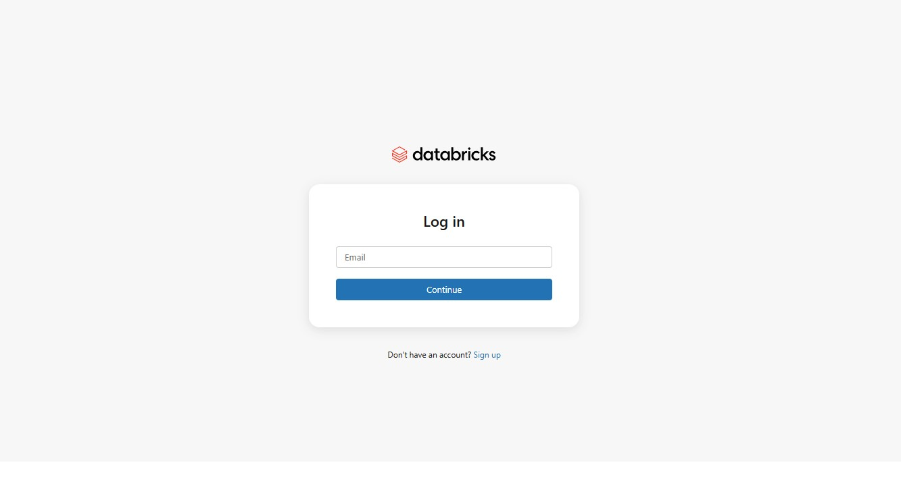
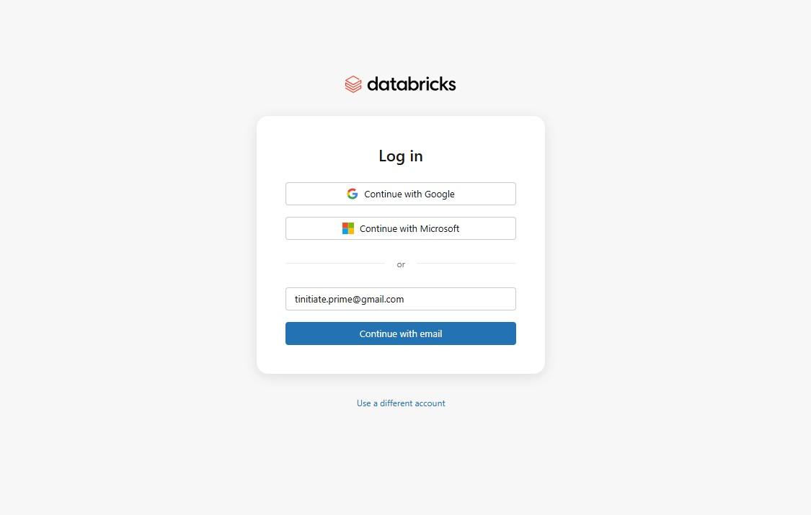
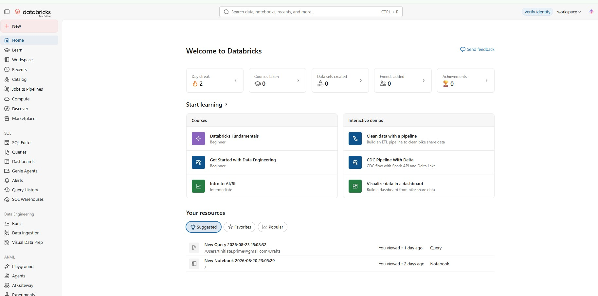
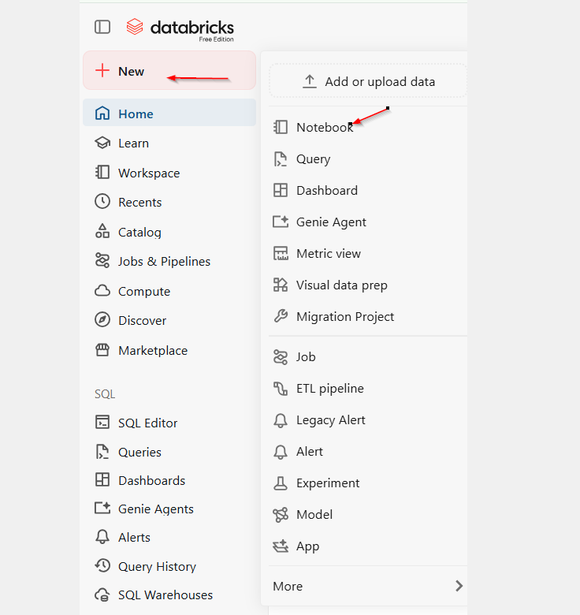
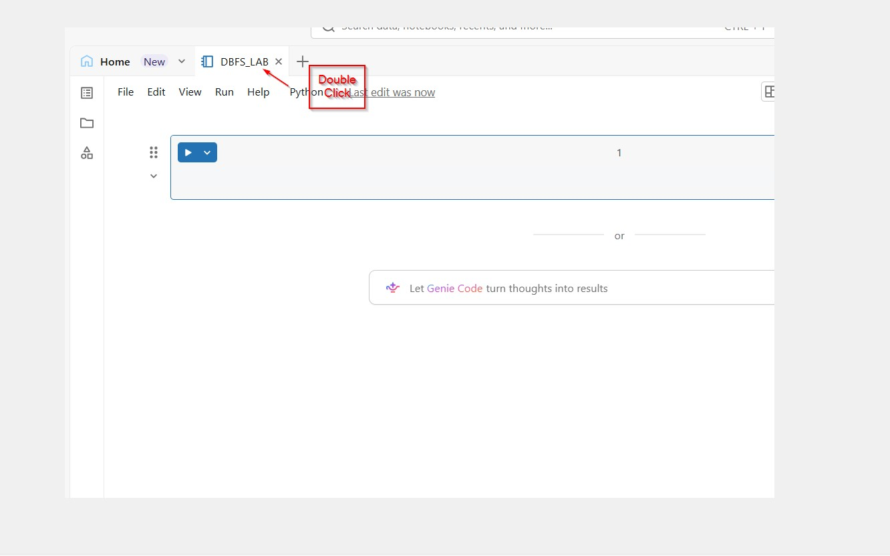
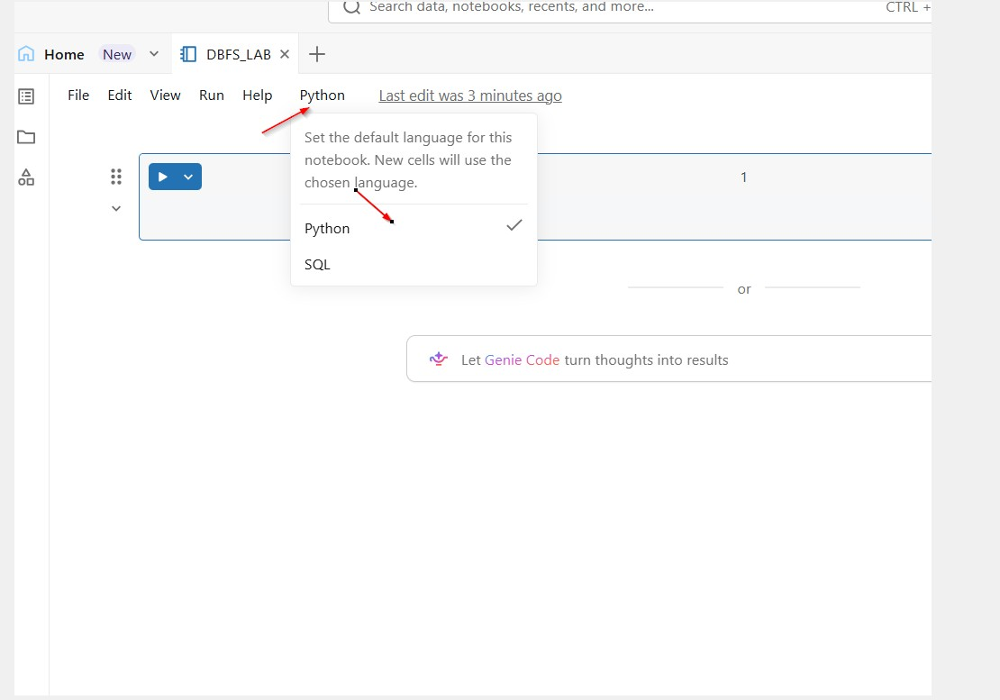

# Databricks Setup Guide

This guide explains how students should open the project in Databricks and run the exercises.

## Step 1: Open your Databricks workspace

Use the Databricks login page to open your workspace:

- Databricks login: https://accounts.cloud.databricks.com/login
- Or your workspace URL, for example: https://<your-workspace-name>.cloud.databricks.com

### 1. Open the Databricks login page

- Go to the Databricks login page or your workspace URL.
- You should see the Databricks sign-in screen.

### 2. Sign in with your account

- Choose Continue with Google, Continue with Microsoft, or enter your email.
- Use your Databricks account details to sign in.

### 3. After login, open the workspace

- Once signed in, you will land on the Databricks workspace home page.
- This is the main landing area where you can create notebooks and upload project files.

> Replace `<your-workspace-name>` with the actual workspace name provided by your Databricks administrator.

## Step 2: Create a new Python notebook

- Click **+ New** in the left sidebar.
- Select **Notebook** from the menu.
- Name the notebook **DBFS_Lab**.
- Once the notebook opens, choose **Python** from the notebook language selector at the top.
- The notebook is ready to use after the language is set.

### 1. Click + New and choose Notebook

### 2. Name the notebook

### 3. Set the language to Python

## Step 3: Run the notebook cells in order

- Start with the first cell.
- Run each cell one by one.
- Do not skip ahead.
- Wait for the output and confirm each step completes successfully.
- Continue to the next cell only after the previous cell has finished running.

## Typical flow

Students usually do the following in order:

1. Create a folder in DBFS.
2. Create or upload a file.
3. List files and confirm the file exists.
4. Read the file into a Spark DataFrame.
5. Run a SQL query on the DataFrame.
6. Rename the folder.
7. Update the file.
8. Clean up the workspace.

## Important note

These exercises are designed to run in a Databricks notebook environment with a running cluster. Students should not treat this as a local terminal-only project unless they are intentionally testing code outside Databricks.
